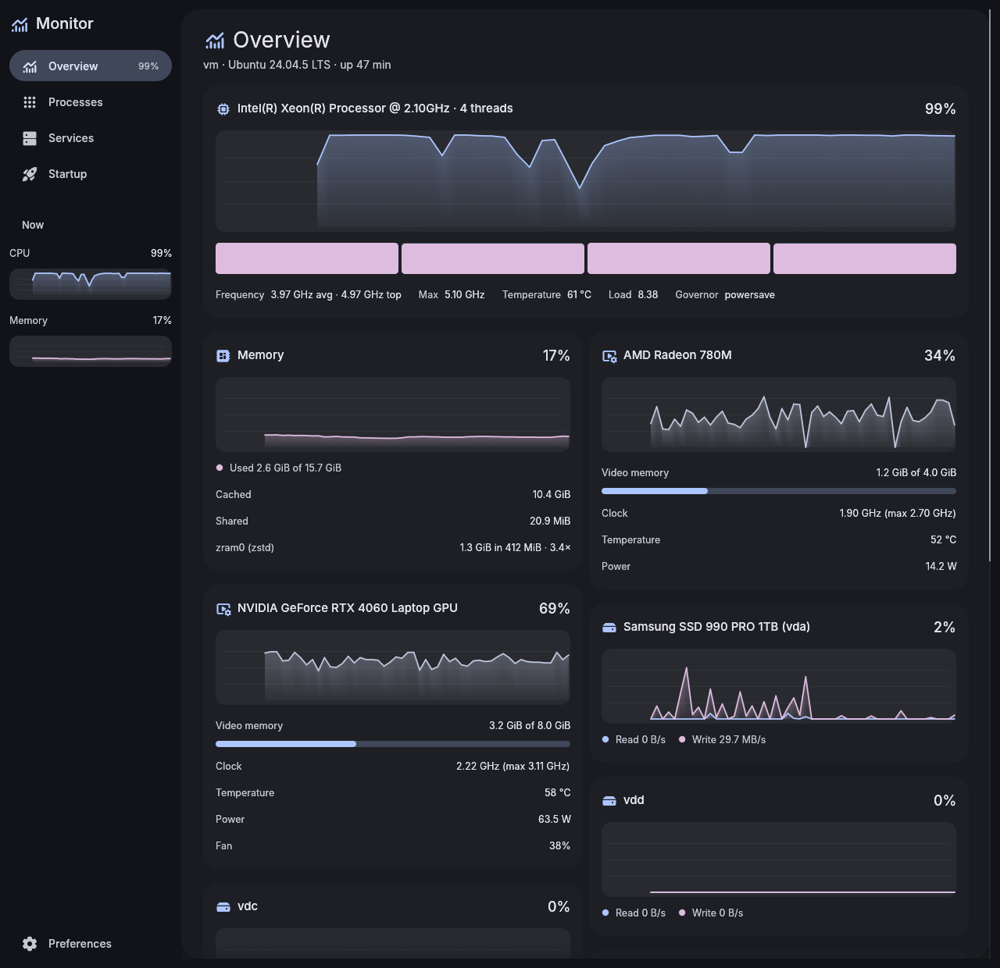
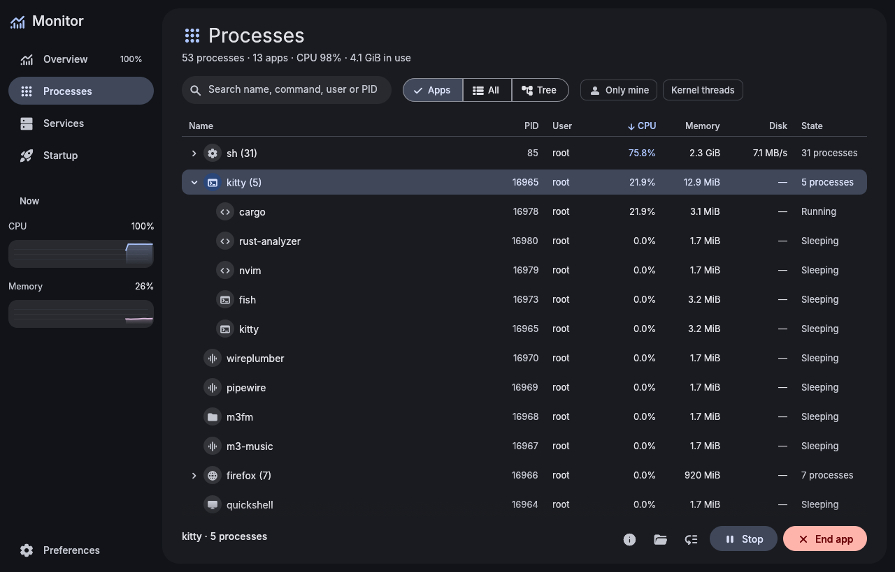
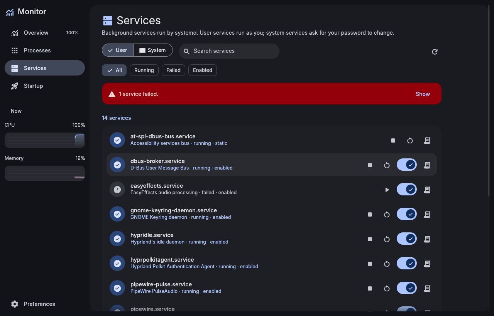
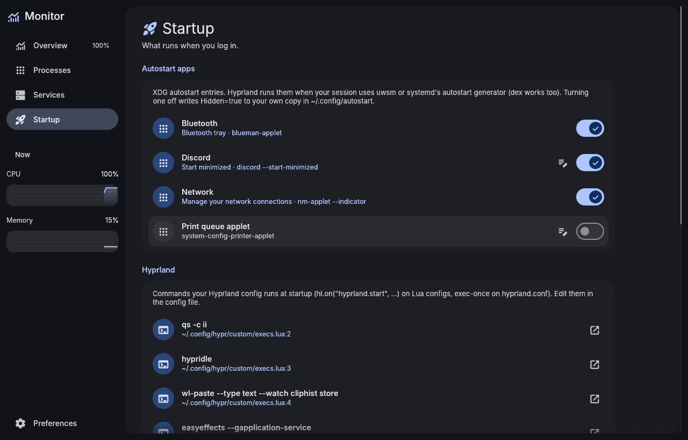

# Material 3 Monitor

A system monitor for Arch Linux and Hyprland, built with [egui](https://github.com/emilk/egui) and themed with Material You to match the [Material 3 File Manager](https://github.com/bhimio1/material-3-file-manager-rust), [Settings](https://github.com/bhimio1/material-3-settings) and the rest of the family. On an end4-pC desktop it takes its colors from your wallpaper, like the shell does. It uses the shared [material-3-ui](https://github.com/bhimio1/material-3-ui) crate.






## Features

**Overview**
- **CPU:** a live chart of total usage over the last minute, a bar per core, average and top frequency, temperature, load average and the cpufreq governor. Hover the bars for each core's load and clock.
- **Memory:** used memory and swap in one chart, cache and shared memory, and each zram device with its compression ratio.
- **GPUs:**
  - AMD: usage, video memory, clock, temperature, power and fan, from amdgpu's sysfs files;
  - NVIDIA: the same, from `nvidia-smi` (polled once a second on its own thread);
  - Intel: clock and temperature (usage needs root, so it isn't shown).
- **Disks:** read and write speed and busy time per disk. Idle disks with nothing mounted are left out. A Storage tile shows free space on each filesystem (btrfs subvolumes count once).
- **Network:** download and upload speed per interface, plus totals since boot. Virtual interfaces (bridges, VPNs, containers) are hidden unless you turn them on.
- **Sensors:** every hwmon temperature with a meter scaled to its critical limit, and fan speeds.
- **Battery:** charge, status, power draw, time to empty or full, health and cycle count.
- **System:** kernel, uptime, load, tasks, context switches and pressure stall information (`/proc/pressure`).
- **Gaming:** Game Mode and the running game from [Material 3 Games](https://github.com/bhimio1/material-3-games), the sched-ext scheduler (`scxctl`, as on CachyOS), the power profile and GameMode. Each line appears when its tool is installed.

**Processes**
- **Three views:**
  - **Apps:** processes grouped into the app they belong to (a terminal and everything in it, a browser and its content processes);
  - **All:** every process;
  - **Tree:** parents and children, with collapsible branches.
- **Columns:** CPU, memory, disk I/O, PID, user and state, sortable by clicking a header. Search matches the name, command line, user or PID.
- **Filters:** "Only mine", and kernel threads (hidden by default).
- **Actions:** select a row, or right-click it, to:
  - **End** or **Kill** a process or a whole app, after confirming;
  - **Stop** and **Continue** it;
  - change its **priority** (nice);
  - **open its file location** in the file manager;
  - see its **details**: command line, executable, working folder, start time, threads and priority.

  Processes of other users, and raising priority, go through `pkexec`.

**Services**
- systemd user and system services, with filters for running, failed and enabled ones, and a banner when something failed.
- Start, stop, restart, and enable or disable at boot. System services ask for your password through polkit.
- The last 200 lines of a service's journal (`journalctl`).

**Startup**
- **Autostart apps** (`~/.config/autostart` and `/etc/xdg/autostart`), with a switch each. Turning a system entry off writes `Hidden=true` to your own copy, so the system file stays untouched.
- **Hyprland's startup commands**, read-only. These are `hl.on("hyprland.start", …)` blocks on Lua configs, with `require`d files followed, and `exec-once` lines on `hyprland.conf`, with `source`d files followed. Each one links to its file and line.
- **Enabled user services**, with a Disable button.

**Low overhead**
- Sampling runs on a background thread about once a second. The window only redraws when a new sample arrives.
- Processes are only read while the Processes page is open.
- By default, sampling pauses while the window is in the background.

## Install

From the AUR, prebuilt or built from source:

```sh
paru -S material-3-monitor-bin   # or material-3-monitor-git
```

Or from Material 3 Settings → **Material 3 apps**, or with the included PKGBUILD:

```sh
cd packaging
makepkg -si
```

Prebuilt x86_64 binaries are attached to [releases](https://github.com/bhimio1/material-3-monitor/releases).

Or build directly:

```sh
cargo build --release
./target/release/m3-monitor [--page overview|processes|services|startup|preferences]
```

Bind it in Hyprland (end-4: `~/.config/hypr/custom/keybinds.lua`), for example to Ctrl+Shift+Escape:

```lua
hl.bind("CTRL + SHIFT + Escape", hl.dsp.exec_cmd("m3-monitor --page processes"))
```

## Preferences

In Preferences, **Appearance** works as in the other apps: **Auto** uses the end-4 shell's generated colors (`~/.local/state/quickshell/user/generated/colors.json`). If those don't exist it uses the file manager's matugen `theme.json`, and otherwise a seed color. You can also set the update interval (0.5–5 s), how much history the charts show (1–5 minutes), pausing in the background, virtual interfaces, and confirmation before ending processes. Preferences are stored in `~/.config/m3-monitor/config.toml`.

## Project layout

```
src/
  app.rs        app state, sidebar, background jobs
  sample/       the sampler thread and its parsers:
    cpu.rs        /proc/stat, cpufreq, loadavg, uptime
    mem.rs        /proc/meminfo, zram, /proc/pressure
    io.rs         /proc/diskstats, /proc/net/dev
    sensors.rs    hwmon temperatures and fans, batteries
    gpu.rs        amdgpu sysfs, nvidia-smi, Intel frequencies
    procs.rs      process rows, app grouping, tree, signals and renice
    history.rs    rolling chart history
  services.rs   systemctl / journalctl
  startup.rs    XDG autostart, Hyprland startup commands
  gaming.rs     m3-games status, scxctl, power profile, GameMode
  ui/           one module per page
  ui_ext.rs     charts, meters and tiles (candidates for material-3-ui)
tests/fixtures/ a fake /sys (sensors, GPUs, battery, zram), nvidia-smi output,
                systemd and autostart data, used by tests and screenshots
```

Run the tests with `cargo test`. To try the sensor, GPU and battery tiles on a machine without them, or to reproduce the screenshots, point the monitor at the fixtures:

```sh
M3_MONITOR_SYSROOT=tests/fixtures/sys \
M3_MONITOR_NVIDIA_SMI=tests/fixtures/nvidia-smi.csv \
M3_MONITOR_SERVICES_FIXTURE=tests/fixtures/services \
cargo run
```

## License

MIT, see [LICENSE](LICENSE).

Fonts: Inter (SIL OFL 1.1, see `assets/LICENSE-Inter.txt`). Icons: Material Symbols, via `egui_material_icons`.
